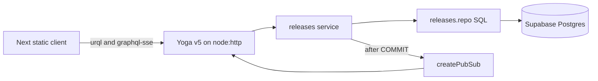

# ReleaseCheck build plan

Backend first. The frontend starts only after acceptance tests 1–14 pass. `yarn test` must pass after each backend operation.

Sources, in order when they disagree:

- [docs/design-doc.md](docs/design-doc.md) and [docs/DESIGN_SYSTEM.md](docs/DESIGN_SYSTEM.md) once the specs are moved. Until that move, the copies at the repo root are the same text.
- [AGENTS.md](AGENTS.md) for stack, layout, and the operation order.
- Cursor rules only where they do not add a forbidden dependency or change the schema, the API, or the visual design.

The rules used for this rebuild are [.cursor/rules/graphql-yoga.mdc](.cursor/rules/graphql-yoga.mdc), [.cursor/rules/cursor-node-express.mdc](.cursor/rules/cursor-node-express.mdc), [.cursor/rules/nextjs-react-generalist-cursor-rules.mdc](.cursor/rules/nextjs-react-generalist-cursor-rules.mdc), and [.cursor/rules/optimized-nextjs-typescript-best-practices-modern-ui-ux.mdc](.cursor/rules/optimized-nextjs-typescript-best-practices-modern-ui-ux.mdc).

## What the rules change

Use these. They match the design doc.

- GraphQL Yoga v5 on `node:http`. `createYoga({ schema: createSchema({ typeDefs, resolvers }), graphqlEndpoint: "/graphql", cors, graphiql })`. `createServer(yoga)` listens on `PORT`.
- Subscriptions use `createPubSub()` from `graphql-yoga`. Clients use SSE. No WebSocket server.
- [server/src/graphql/pubsub.ts](server/src/graphql/pubsub.ts) still exposes only `publish(change)` and `subscribe()`. Internally that is one topic. Publish only after `COMMIT`.
- Errors that clients may see are `GraphQLError` with `extensions.code`. Unexpected errors stay masked in every environment. Log the real error and return `INTERNAL_SERVER_ERROR`. Do not set `maskedErrors: false`.
- GraphiQL follows `GRAPHIQL_ENABLED` (`true` locally, `false` in production), not `NODE_ENV` alone.
- CORS origin comes from `CORS_ORIGIN`.
- Queries and mutations are tested with `yoga.fetch` so they do not need an open port. Subscription tests read the SSE body from that same fetch. Reset the pub/sub singleton between cases.
- One shared `pg` `Pool`. Transactions use one client, `BEGIN`, then `COMMIT` or `ROLLBACK` in `finally`, and always `release`. Close the HTTP server and the pool on `SIGINT` and `SIGTERM`.
- Server code is async/await. Validation uses early returns. Input is never interpolated into SQL.
- Frontend components are functions, not classes. Names tell state apart (`isLoading`, `hasError`). Guard clauses handle the empty list, a missing release, and a validation error before the main render.
- `'use client'` is required for urql, `sessionStorage`, and the SSE subscription. Static export cannot load a release on the server. Do not add React Server Components for data.

## What the rules do not change

Leave these out. The design doc and AGENTS.md already forbid them, and the generic rules do not override that.

- Express, REST routes, and API versioning. The only HTTP API is `POST /graphql`.
- An ORM, Zod, DataLoader, Zustand, TanStack Query, Jest, and React Testing Library.
- Tailwind, shadcn, and Radix. Styling is the CSS custom properties in the design system.
- JWT, sessions, OAuth, and roles. The app is single-user. `clientId` identifies a tab, not a user.
- Docker, response cache, depth-limit, and rate-limit plugins.
- Redis pub/sub. One process is the deployment. The in-memory bus is correct.
- File uploads.
- `npm install` and `tsx`. Yarn owns the lockfile. Run the API with `tsc` and `node --watch`, and load env with Node's `--env-file`.
- Editing name or due date, pagination, step history, and a shared broker. Those stay stretch items.

N+1 is avoided by the design-doc query `WHERE release_id = ANY($1)`, not by DataLoader.

## 0. Scaffold, then stop for database URLs

Move [design-doc.md](design-doc.md) and [DESIGN_SYSTEM.md](DESIGN_SYSTEM.md) into `docs/` without editing their rules.

Yarn 4 workspace, `nodeLinker: node-modules`, `.nvmrc` of `20`, private root `package.json` with workspaces `web` and `server`, one `yarn.lock`. Root scripts: `dev` runs both workspaces, `test` runs server tests, `build` builds both.

Server dependencies, in the server workspace only: `graphql` (peer of Yoga), `graphql-yoga`, `pg`, `node-pg-migrate`, `vitest`, `typescript`, `@types/node`, `@types/pg`. Web dependencies, in the web workspace only: `next`, `react`, `react-dom`, `urql`, `graphql`, `graphql-sse`.

[server/.env.example](server/.env.example): `DATABASE_URL`, `TEST_DATABASE_URL`, `PORT` (4000), `CORS_ORIGIN`, `GRAPHIQL_ENABLED`.

[web/.env.example](web/.env.example): `NEXT_PUBLIC_GRAPHQL_URL`.

Integration tests need a Supabase test project URL in `server/.env` that is not the dev database. Unit tests do not. If that URL is missing when integration work starts, stop and ask.

## 1. Backend foundation

Layout under [server/](server/):

- [server/src/services/status.ts](server/src/services/status.ts) is the only status function. 0 completed steps returns `PLANNED`, 1–6 returns `ONGOING`, 7 returns `DONE`. Unit tests cover those three bands.
- [server/src/steps.ts](server/src/steps.ts) exports `STEP_DEFINITIONS` in design-doc order and labels.
- [server/src/validation.ts](server/src/validation.ts) and [server/src/errors.ts](server/src/errors.ts). Trimmed name of 1–100 characters, real `YYYY-MM-DD` (past dates allowed), notes at most 2000 with blank stored as `null`, UUID ids, `clientId` of 1–64 characters. Failures throw `GraphQLError` with `extensions.code` of `BAD_USER_INPUT` and `extensions.field`. `NOT_FOUND` uses the same helper. Unit tests cover design-doc section 6.
- [server/migrations/1700000000000_init.sql](server/migrations/1700000000000_init.sql) is the schema in design-doc section 2. The down migration drops `release_step`, then `release`, then `step_key`.
- [server/src/data/db.ts](server/src/data/db.ts) is one shared `Pool`. [server/src/data/releases.repo.ts](server/src/data/releases.repo.ts) is parameterised SQL only. The repo never imports GraphQL types.
- [server/src/graphql/schema.graphql](server/src/graphql/schema.graphql) is the only schema, copied from design-doc section 4. Load it into `createSchema`.
- [server/src/index.ts](server/src/index.ts) builds Yoga and listens. The Pool is a module singleton, not a pool created per request. Resolvers in [server/src/graphql/resolvers.ts](server/src/graphql/resolvers.ts) validate, call [server/src/services/releases.ts](server/src/services/releases.ts), and map results. They never run SQL. `web` and `server` never import each other.

## 2. Backend operations, in this order

Each step adds the service, the resolver, and the integration coverage, then runs `yarn test`. Truncate with `TRUNCATE release CASCADE` before each integration test. List queries load steps with one `WHERE release_id = ANY($1)` query.

- **createRelease.** One transaction inserts `release` and seven unchecked rows from `unnest(enum_range(NULL::step_key))`. Status is `PLANNED`. Tests 1 and 9 (empty name writes nothing and publishes nothing).
- **releases and release.** Sort by `due_date`, then `name`. Unknown id returns `null`. Empty database returns `[]`. Test 13 (ten releases, 70 steps, one steps query).
- **setStepCompleted.** Explicit boolean, not a toggle. `UPDATE` must affect one row; zero rows is `NOT_FOUND`. Tests 2–5 and 8.
- **updateReleaseNotes.** Single `UPDATE ... RETURNING`. Blank becomes `null`. Missing release is `NOT_FOUND`. Test 6.
- **deleteRelease.** Single statement, cascade, returns `true`. Second delete is `NOT_FOUND`. Test 7.
- **Subscription.** SSE on the same `/graphql` path when `Accept` is `text/event-stream`. Keepalive every 15–30 seconds. Before the client is written, confirm that path in GraphiQL and record it in the README. If Yoga needs a different path, update design-doc section 4 before continuing. Tests 10–12. Drift test 14 compares `STEP_DEFINITIONS` with `pg_enum`.

Optional seed script inserts the mockup sample releases. It is not part of the migration.

## 3. Frontend, only after tests 1–14 pass

Next.js App Router with `output: 'export'` in [web/next.config.mjs](web/next.config.mjs). Directories stay lowercase. Component files keep the names in AGENTS.md, because that layout is more specific than the generic Next rule.

Static export cannot serve a newly created id as a server route, so there are two static pages:

- `/` is the list.
- `/release` is the form. No `id` query means new. `?id=<uuid>` means an existing release.

urql and `graphql-sse` use `NEXT_PUBLIC_GRAPHQL_URL`. Documents live in [web/src/graphql/](web/src/graphql/). [web/src/lib/clientId.ts](web/src/lib/clientId.ts) stores `crypto.randomUUID()` in `sessionStorage` under `releasecheck.clientId`. Every mutation sends it. The subscription listener drops events whose `sourceClientId` matches this tab.

Components: `Table`, `ReleaseForm`, `StepCheckbox`, `ChangeBanner`. CSS custom properties from the design system on `:root`. System font stack. Inline SVGs for the eye, trash, and check icons. No status colours, badges, dark mode, or icon library. Below 900px the name and date stack, the table scrolls sideways, and touch targets are at least 40px.

Behaviour:

- List columns: Release, date as `September 20, 2022`, status text `Planned` / `Ongoing` / `Done` from the server enum, View, Delete. Empty copy: "No releases yet. Click New release to add one." Delete calls `deleteRelease`.
- Header on every page: "ReleaseCheck" and "Your all-in-one release checklist tool". Breadcrumb "All releases" links home. The current crumb is "New release" or the release name.
- Create sends `createRelease` with name, date, and notes. Checklist rows are visible and unchecked. If the user marks any before save, those explicit `setStepCompleted` calls run after create succeeds, then the page moves to `?id=`. Name and date are not editable after that.
- On an existing release, a checkbox click sends `setStepCompleted` immediately. Save sends `updateReleaseNotes` only. A null `release` renders "This release no longer exists." and a link back. Validation errors render under the field.
- The banner sits above the card. One `STEP_CHANGED` uses the step label, for example "Tests passing was checked in another tab" (unchecked uses "unchecked"). One `NOTES_CHANGED` says "Notes were updated in another tab". Two or more collapse to "3 changes from another tab". The close button dismisses it. `RELEASE_CREATED` and `RELEASE_DELETED` refresh the list with no banner. Reconnect refetches the open release.

The client does not compute status. It renders the enum the server returns.

Verify the list, create, check a step, edit notes, delete, empty state, not-found state, and a second tab's banner in the browser. Check a wide width and a width below 900px.

## 4. Wire-up

README covers install, env vars, migrate, `yarn dev`, test, the confirmed GraphQL SSE path, and how to reach the API, the static site, and Supabase. Deploy (Render native Node, Vercel root `web`) waits until you want it and have the hosting projects.
