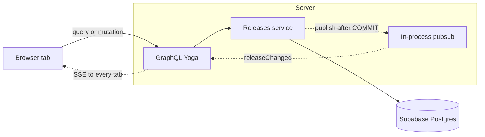

# ReleaseCheck

A checklist for tracking a software release. Each release has a name, a due date, optional notes, and seven fixed steps. Status is calculated from those steps and is never stored.

**Last reviewed:** 25 October 2026

## Overview

ReleaseCheck is a single-user tool. The Next.js app in `web` talks to the GraphQL API in `server`. The API stores releases in Supabase Postgres. There is no login. Name and due date cannot be edited after a release is created. The seven steps are fixed: merged pull requests, changelog, tests, GitHub release, demo deploy, demo testing, and production deploy.

The list is sorted by due date, then name. Status is Planned when no step is done, Ongoing when at least one is done, and Done when all seven are done. A past due date is allowed. An empty list tells you to add a release.

**Create.** New release asks for a name and a date. Notes are optional. Every step starts unchecked, and you can check steps before the first save. Save creates the release and returns to the list. A blank or over-long name, a name that matches an existing release regardless of letter case, an impossible date, or notes over 2,000 characters stay on the form with an error. Blank notes are stored as empty.

**Update.** On an existing release, checkbox and notes edits stay on that form until Save. Save writes only the steps and notes that differ from the version loaded in that tab. Leaving without Save discards the draft. The tab that saved does not show a banner for its own change.

**Delete.** Delete asks for approval first. Approving removes the release and its steps, then returns to the list. Cancel leaves it in place. Opening a release that was already deleted shows that it no longer exists, with a link back to the list. Deleting the same release again does not recreate it.

**Multiple tabs.** A toggle or note that has not been saved stays on the tab that made it. The homepage list and each release's detail are cached in that tab. After a successful save, every other open tab refreshes that release's cached detail. A step or notes change shows a dismissible banner when the tab is on the form, for example Checkbox "All tests are passing" was checked in another tab. Several changes collapse into "3 changes from another tab". The list refetches when a release is created or deleted, and when its steps are saved, so the status column matches the checklist. A notes-only save leaves the list cache as it is. Those list updates show on every open tab. If another tab is mid-edit, it keeps that draft and still shows the banner. A later save from that draft sends only what it changed, and the same step is last save wins. A tab that reconnects refetches the open release.

## Local development setup

### Prerequisites

- Node.js 20 or later (`.nvmrc` is `20`)
- Yarn 4.9.2, the version in the root `packageManager` field. Enable it with Corepack: `corepack enable`
- A Supabase project for development, and a second Supabase project for tests
- Docker, if you want the container stack. `yarn dev:up` calls the `docker-compose` binary

Install once from the repository root. Do not run `npm install` inside `web` or `server`.

```bash
yarn install
```

A global Yarn 1.x install fails the `packageManager` check. Use `corepack yarn` for the commands below if `yarn` is still 1.x.

### Environment variables

Copy the examples and fill in real values. Do not commit `server/.env` or `web/.env.local`.

```bash
cp server/.env.example server/.env
cp web/.env.example web/.env.local
```

| Variable | Used by | Purpose | Where to get it |
|---|---|---|---|
| `DATABASE_URL` | server, migrations | Dev database. Use the Supabase session pooler string from `.env.example` | Supabase, Project Settings, Database |
| `TEST_DATABASE_URL` | server tests | A different Supabase project. Tests run `TRUNCATE release CASCADE` | A second Supabase project |
| `PORT` | server | API port. Default `4000` | `server/.env` |
| `CORS_ORIGIN` | server | Allowed frontend origin, `http://localhost:3000` locally | `server/.env` |
| `GRAPHIQL_ENABLED` | server | `true` locally, `false` in production | `server/.env` |
| `NEXT_PUBLIC_GRAPHQL_URL` | web | Full GraphQL URL, `http://localhost:4000/graphql` locally. Baked in at build time | `web/.env.local` |

`TEST_DATABASE_URL` must not point at the dev database.

Apply the schema before the first start:

```bash
yarn workspace server migrate:up
```

Roll back the last migration:

```bash
yarn workspace server migrate:down
```

### Running locally

```bash
yarn start
```

The API listens on http://localhost:4000/graphql. The app listens on http://localhost:3000.

Open the app, choose **New release**, and save a name and date. The new form is at `/release`. An existing release is at `/release?id=<uuid>`.

On an existing release, checkbox and notes edits stay on that form until **Save**. Other open tabs do not change until the save succeeds. Each of them then shows a banner, for example: Checkbox "All tests are passing" was checked in another tab. Leaving the form without saving discards the draft.

GraphiQL is at http://localhost:4000/graphql when `GRAPHIQL_ENABLED=true`. Queries, mutations, and subscriptions all use `POST /graphql`. Subscriptions are server-sent events on that same URL.

Docker, with the daemon already running:

```bash
yarn dev:up
yarn dev:down
```

`yarn dev:up` builds and stays attached to the logs. After both containers are healthy it prints:

```text
Frontend  http://localhost:3000
Backend   http://localhost:4000/graphql
```

The site container publishes port 3000. The API container reads `server/.env`. Run `yarn workspace server migrate:up` on the host before the first Docker start. The database is not a container. Ctrl+C stops the stack. `yarn dev:down` stops it and leaves the named volumes in place.

### Running tests

```bash
yarn test
yarn workspace server test:unit
```

`yarn test` runs the server unit tests and the integration tests. Integration tests need `TEST_DATABASE_URL` and the migrations applied there. They truncate `release` before each test file.

Build both workspaces:

```bash
yarn build
```

## Architecture

`web` and `server` are Yarn workspaces. They share nothing except the GraphQL API. The browser uses urql. The API is GraphQL Yoga on `node:http`, with raw SQL through one `pg` pool. There is no ORM. Status is computed on the server from the seven step rows. The client renders what the server returns.



Queries and mutations are `POST /graphql`. After `COMMIT` the service publishes `releaseChanged` on the in-process bus. Yoga streams that event to every connected tab as server-sent events on the same URL. Each tab stores a `clientId` in `sessionStorage` and ignores events it sent itself.

### What is cached

Each tab has its own urql document cache. Tabs do not share memory. Nothing is cached on the server. Status is computed on each read. Unsaved checklist and notes edits live in the form, not in this cache. The new-release form has no detail entry.

| Cache | Stored result | Policy | Filled when |
|---|---|---|---|
| Homepage list | The `releases` query: every release, including status and steps | cache-first. The query stays mounted for the whole visit in `CachedReleaseList`, so leaving the list does not drop it | First time this tab reads the list |
| Release detail | The `release(id)` query, one entry per release | cache-first | First open of that release, or a background read while the tab is on another page |

### When a cache is invalidated

A refetch is `network-only`. The list uses the mounted query, `revalidateReleaseList` in `web/src/lib/release-list.ts`. A detail uses the open form's query when that release is on screen, and otherwise a one-off read into the same cache key, `revalidateReleaseDetail` in `web/src/lib/release-detail.ts`. `SetStep` and `UpdateNotes` have `__typename` removed, so those mutation results do not invalidate either cache by themselves. `createRelease` keeps `__typename`, so urql invalidates the list in the creating tab.

| Event | When | List | Detail for that release | Banner |
|---|---|---|---|---|
| `createRelease` succeeds | Saving tab, after commit | Invalidated by the `Release` result. If the new release also saved steps, the tab refetches the list again after those writes | No entry. The new form does not read `release(id)` | No |
| `RELEASE_CREATED` | Every other tab, after commit | Refetch | Left as it is | No |
| Step writes finish | Saving tab, once, after the last successful `setStepCompleted`. Its own event is ignored | Refetch, so status matches the checklist | Explicit read | No |
| `STEP_CHANGED` | Every other tab, one event per saved step | Refetch | Refetch, including a tab that is not on that release | Yes, on the list and on an open form. A dirty draft is kept |
| Notes save succeeds | Saving tab, after `updateReleaseNotes`. Its own event is ignored | Left as it is. Notes do not change status | Explicit read | No |
| `NOTES_CHANGED` | Every other tab, after commit | Left as it is | Refetch | Yes. A dirty draft is kept |
| Delete from the list | Saving tab, after confirm. Its own event is ignored | That row is hidden locally. The query is not refetched. `deleteRelease` returns a boolean, so urql does not drop the list | Left as it is | No |
| Delete from the form | Saving tab, after confirm, then it returns home. Its own event is ignored | That row is hidden locally, same as a delete from the list. The query is not refetched | Explicit read, which comes back empty | No |
| `RELEASE_DELETED` | Every other tab, after commit | Refetch | Refetch. An open form shows that the release no longer exists | No |
| Subscription retries | Only after a dropped connection reconnects, and only while a form is open. Opening a page does not count | Left as it is | The open release is refetched | No |
| Open a page again | Same tab, no new event | Cache hit | Cache hit for that id | No |

### Across open tabs

Tabs stay aligned through the subscription. The table above is what each event does to the two caches.

1. The saving tab sends the mutation with its `clientId`.
2. The service commits, then publishes one event on the in-process bus.
3. Yoga writes that event to every connected subscription.
4. A tab whose `clientId` matches `sourceClientId` drops the event.
5. Any other tab applies the row for that event.

A tab sitting on the form still updates its list cache, because the list query and the subscription stay mounted after the user leaves the homepage.

### Key files

| Path | Purpose |
|---|---|
| `docs/design-doc.md` | Schema, operations, validation, and tests |
| `docs/DESIGN_SYSTEM.md` | Colours, type, spacing, and components |
| `server/src/graphql/schema.graphql` | The GraphQL schema |
| `server/src/releases/` | Release resolver, service, and SQL |
| `server/migrations/` | SQL migrations |
| `web/src/components/Providers.tsx` | urql provider and the mounted releases query |
| `web/src/lib/client.ts` | Document cache, and the exchange that keeps step and notes saves from clearing the list |
| `web/src/lib/release-detail.ts` | Cache refresh for one release |
| `web/src/lib/useRemoteChanges.ts` | Subscription handler for other tabs |
| `web/src/components/ReleaseForm.tsx` | Create and edit form |
| `web/src/components/Table.tsx` | Release list |
| `server/src/graphql/pubsub.service.ts` | In-process event bus, published after commit |
| `docker-compose.yaml` | API, static site, and the startup banner |

## Stress test

A stress test of the API and the live subscription is in progress. It is not part of `yarn test` yet, and there is no run command. This section will record how to run it and what it covers when that work is ready.

## Deployment

The API is a native Node service on Render, without Docker. Build with `yarn workspace server build` and start with `yarn workspace server start`. Set the server environment variables there, with `GRAPHIQL_ENABLED=false`.

The web app is a static Next.js export. On Vercel, set the root directory to `web`. `NEXT_PUBLIC_GRAPHQL_URL` must be the public API URL ending in `/graphql`. Set `CORS_ORIGIN` on the API to that Vercel origin.

Vercel’s default `yarn` is 1.22, which ignores these workspaces and does not install `next`. `.yarnrc.yml` points `yarnPath` at the committed Yarn 4.9.2 binary in `.yarn/releases`, so that install hands off to Yarn 4. Keep that file in git.

The database stays on Supabase. Point `DATABASE_URL` at the session pooler and run `yarn workspace server migrate:up` against it once.

Production URLs are not recorded in this repo.

## Runbooks

### Seed sample releases

Build the server first. Seed reads `server/dist/seed.js` and inserts three sample releases into the dev database.

```bash
yarn workspace server build
yarn workspace server seed
```

### Work on one workspace

```bash
yarn workspace server dev
yarn workspace web dev
```

The API reloads when its TypeScript changes. The Next.js dev server is the second command.

## Troubleshooting

### `yarn` reports a packageManager mismatch

**Symptom:** Yarn 1.22 refuses to run because `packageManager` is `yarn@4.9.2`.  
**Cause:** Yarn 1 did not follow `yarnPath` to the committed Yarn 4 binary.  
**Fix:** Confirm `.yarn/releases/yarn-4.9.2.cjs` exists and `.yarnrc.yml` points `yarnPath` at it. `corepack enable` also selects Yarn 4.

### `docker compose up --build` says `unknown flag: --build`

**Symptom:** Docker prints its own usage text.  
**Cause:** This machine's Docker CLI has no Compose plugin. The project script calls `docker-compose`.  
**Fix:** `yarn dev:up`.

### The API container cannot resolve the Supabase host

**Symptom:** Server logs show `getaddrinfo ENOTFOUND` for `db.<project>.supabase.co`.  
**Cause:** That host is IPv6-only. The Docker VM has no IPv6 route.  
**Fix:** Use the session pooler host from `server/.env.example` (`aws-0-<region>.pooler.supabase.com`, user `postgres.<project-ref>`).

### Tests deleted the dev releases

**Symptom:** The dev database is empty after `yarn test`.  
**Cause:** `TEST_DATABASE_URL` points at the same database as `DATABASE_URL`.  
**Fix:** Point `TEST_DATABASE_URL` at a separate Supabase project.

## Contributing

Read `AGENTS.md` before changing code. `docs/design-doc.md` is the source of truth for the schema, operations, and tests. `docs/DESIGN_SYSTEM.md` is the source of truth for UI. Update the matching doc before changing that behavior. `web` and `server` do not import each other.

## License

[MIT](LICENSE)

## Related docs

- [Design doc](docs/design-doc.md)
- [Design system](docs/DESIGN_SYSTEM.md)
- [Agent instructions](AGENTS.md)
