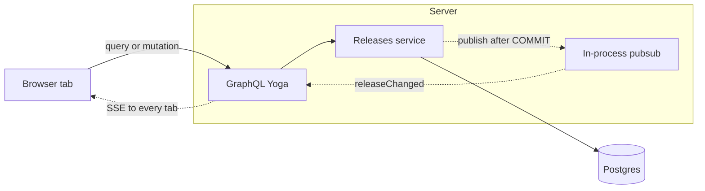

# ReleaseCheck

A checklist for tracking a software release. Each release has a name, a due date, optional notes, and seven fixed steps. Status is calculated from those steps and is never stored.

**Last reviewed:** 25 October 2026

## Overview

ReleaseCheck is a single-user tool with no login. A release has a name, a due date, optional notes, and seven fixed steps. The name and date stay as they were created. Status is Planned, Ongoing, or Done from how many steps are done.

Create asks for a name and date, then returns to the list. Checklist and notes edits stay on the form until Save. Delete asks for approval. Another open tab sees a saved change. An unsaved edit stays on the tab that made it.

## Architecture

`web` and `server` are Yarn workspaces. They share nothing except the GraphQL API. The browser uses urql. The API is GraphQL Yoga on `node:http`, with raw SQL through one `pg` pool. There is no ORM. Status is computed on the server from the seven step rows. The client renders what the server returns.



Queries and mutations are `POST /graphql`. After `COMMIT` the service publishes `releaseChanged` on the in-process bus. Yoga streams that event to every connected tab as server-sent events on the same URL. Each tab stores a `clientId` in `sessionStorage` and ignores events it sent itself.

### What is cached

Each tab has its own urql document cache. Tabs do not share memory. Nothing is cached on the server. Status is computed on each read. Unsaved checklist and notes edits live in the form, not in this cache. The new-release form has no detail entry.

| Cache | Stored result | Policy | Filled when |
|---|---|---|---|
| Homepage list | The `releases` query: every release, including status and steps | cache-first. The query stays mounted for the whole visit in `CachedReleaseList`, so leaving the list does not drop it | First time this tab reads the list |
| Release detail | The `release(id)` query, one entry per release | cache-first | First open of that release, or a background read while the tab is on another page |

### When a cache is invalidated

A refetch is `network-only`. The list uses the mounted query, `revalidateReleaseList` in `web/src/lib/release-list.ts`. A detail uses the open form's query when that release is on screen, and otherwise a one-off read into the same cache key, `revalidateReleaseDetail` in `web/src/lib/release-detail.ts`. `SetStep` and `UpdateNotes` have `__typename` removed, so those mutation results do not invalidate either cache by themselves. `createRelease` keeps `__typename`, so urql invalidates the list in the creating tab.

| Event | When | List | Detail for that release | Banner |
|---|---|---|---|---|
| `createRelease` succeeds | Saving tab, after commit | Invalidated by the `Release` result. If the new release also saved steps, the tab refetches the list again after those writes | No entry. The new form does not read `release(id)` | No |
| `RELEASE_CREATED` | Every other tab, after commit | Refetch | Left as it is | No |
| Step writes finish | Saving tab, once, after the last successful `setStepCompleted`. Its own event is ignored | Refetch, so status matches the checklist | Explicit read | No |
| `STEP_CHANGED` | Every other tab, one event per saved step | Refetch | Refetch, including a tab that is not on that release | Yes, on the list and on an open form. A dirty draft is kept |
| Notes save succeeds | Saving tab, after `updateReleaseNotes`. Its own event is ignored | Left as it is. Notes do not change status | Explicit read | No |
| `NOTES_CHANGED` | Every other tab, after commit | Left as it is | Refetch | Yes. A dirty draft is kept |
| Delete from the list | Saving tab, after confirm. Its own event is ignored | That row is hidden locally. The query is not refetched. `deleteRelease` returns a boolean, so urql does not drop the list | Left as it is | No |
| Delete from the form | Saving tab, after confirm, then it returns home. Its own event is ignored | That row is hidden locally, same as a delete from the list. The query is not refetched | Explicit read, which comes back empty | No |
| `RELEASE_DELETED` | Every other tab, after commit | Refetch | Refetch. An open form shows that the release no longer exists | No |
| Subscription retries | Only after a dropped connection reconnects, and only while a form is open. Opening a page does not count | Left as it is | The open release is refetched | No |
| Open a page again | Same tab, no new event | Cache hit | Cache hit for that id | No |

### Across open tabs

Tabs stay aligned through the subscription. The table above is what each event does to the two caches.

1. The saving tab sends the mutation with its `clientId`.
2. The service commits, then publishes one event on the in-process bus.
3. Yoga writes that event to every connected subscription.
4. A tab whose `clientId` matches `sourceClientId` drops the event.
5. Any other tab applies the row for that event.

A tab sitting on the form still updates its list cache, because the list query and the subscription stay mounted after the user leaves the homepage.

### Key files

| Path | Purpose |
|---|---|
| `docs/design-doc.md` | Schema, operations, validation, and tests |
| `docs/DESIGN_SYSTEM.md` | Colours, type, spacing, and components |
| `server/src/graphql/schema.graphql` | The GraphQL schema |
| `server/src/releases/` | Release resolver, service, and SQL |
| `server/migrations/` | SQL migrations |
| `web/src/components/Providers.tsx` | urql provider and the mounted releases query |
| `web/src/lib/client.ts` | Document cache, and the exchange that keeps step and notes saves from clearing the list |
| `web/src/lib/release-detail.ts` | Cache refresh for one release |
| `web/src/lib/useRemoteChanges.ts` | Subscription handler for other tabs |
| `web/src/components/ReleaseForm.tsx` | Create and edit form |
| `web/src/components/Table.tsx` | Release list |
| `server/src/graphql/pubsub.service.ts` | In-process event bus, published after commit |
| `docker-compose.yaml` | Production API and site. The platform supplies the database |
| `docker-compose.dev.yaml` | Local Postgres, pgAdmin, API, and site |

## Local development setup

### Local database

Docker is the only requirement. This path does not use env files.

1. Clone the repository and change into it.
2. Build and start the stack:

```bash
docker-compose -f docker-compose.dev.yaml up --build
```

`yarn dev:test:up` runs that same command. It starts Postgres, pgAdmin, the API, and the site. The API applies migrations as it starts. `yarn dev:up` uses `docker-compose.yaml`, the production file: the API and the site only, with the database supplied by the platform.

3. Wait for the log to print:

```text
Frontend  http://localhost:3000
Backend   http://localhost:4000/graphql
pgAdmin   http://localhost:5050
```

4. Open the frontend and add a release.

pgAdmin signs in as `admin@example.com` with password `releasecheck`. The ReleaseCheck server is already registered: host `postgres`, database `releasecheck`, user `releasecheck`, password `releasecheck`.

Stop the stack with Ctrl+C, or:

```bash
docker-compose -f docker-compose.dev.yaml down
```

`yarn dev:test:down` is the same command. The Postgres volume is kept. `yarn dev:down` stops the production file.

### Hosted Postgres

`docker-compose.yaml` does not start a database. It reads `server/.env`.

1. Copy the example and set the hosted connection string:

```bash
cp server/.env.example server/.env
```

| Variable | Value |
|---|---|
| `DATABASE_URL` | Hosted Postgres URL. On Supabase, use the session pooler (`aws-0-<region>.pooler.supabase.com`, user `postgres.<project-ref>`). The host `db.<project>.supabase.co` is IPv6-only, and the Docker VM cannot reach it. |
| `PORT` | `4000` |
| `CORS_ORIGIN` | `http://localhost:3000` |
| `GRAPHIQL_ENABLED` | `true` |

Do not commit `server/.env`. `TEST_DATABASE_URL` is only for `yarn test`, not for this stack. The site image already calls `http://localhost:4000/graphql`, so `web/.env.local` is not required.

2. Start it:

```bash
yarn dev:up
```

That is `docker-compose up --build`. The API applies migrations on startup. The log prints the site and the API. There is no pgAdmin in this file.

Stop it with `yarn dev:down`.

### Without Docker

Node.js 20 and Yarn 4. `yarn start` runs the API and the Next.js dev server together. It does not start Postgres, and it does not apply migrations.

1. Clone the repository, change into it, and install:

```bash
nvm use
corepack enable
yarn install
```

2. Copy the env files:

```bash
cp server/.env.example server/.env
cp web/.env.example web/.env.local
```

| Variable | File | Value |
|---|---|---|
| `DATABASE_URL` | `server/.env` | Hosted Postgres URL. On Supabase, use the session pooler (`aws-0-<region>.pooler.supabase.com`, user `postgres.<project-ref>`). |
| `PORT` | `server/.env` | `4000` |
| `CORS_ORIGIN` | `server/.env` | `http://localhost:3000` |
| `GRAPHIQL_ENABLED` | `server/.env` | `true` |
| `NEXT_PUBLIC_GRAPHQL_URL` | `web/.env.local` | `http://localhost:4000/graphql` |

Do not commit `server/.env` or `web/.env.local`. `TEST_DATABASE_URL` is only for `yarn test`.

3. Apply migrations once:

```bash
yarn workspace server migrate:up
```

4. Start both workspaces:

```bash
yarn start
```

The API reloads when its TypeScript changes. Open `http://localhost:3000`. The API is `http://localhost:4000/graphql`. Stop with Ctrl+C.

## Stress test

A stress test of the API and the live subscription is in progress. It is not part of `yarn test` yet, and there is no run command. This section will record how to run it and what it covers when that work is ready.

## Deployment

The API is a native Node service on Render, without Docker. Build with `yarn workspace server build` and start with `yarn workspace server start`. Set the server environment variables there, with `GRAPHIQL_ENABLED=false`.

The web app is a static Next.js export. On Vercel, set the root directory to `web`. `NEXT_PUBLIC_GRAPHQL_URL` must be the public API URL ending in `/graphql`. Set `CORS_ORIGIN` on the API to that Vercel origin.

Vercel’s default `yarn` is 1.22, which ignores these workspaces and does not install `next`. `.yarnrc.yml` points `yarnPath` at the committed Yarn 4.9.2 binary in `.yarn/releases`, so that install hands off to Yarn 4. Keep that file in git.

The database stays on Supabase. `docker-compose.yaml` is the API and the site for a platform that injects `DATABASE_URL`, `CORS_ORIGIN`, and `NEXT_PUBLIC_GRAPHQL_URL`. Point `DATABASE_URL` at the session pooler and run `yarn workspace server migrate:up` against it once. The API container also applies pending migrations when it starts.

Production URLs are not recorded in this repo.

## Runbooks

### Seed sample releases

Build the server first. Seed reads `server/dist/seed.js` and inserts three sample releases into the dev database.

```bash
yarn workspace server build
yarn workspace server seed
```

### Work on one workspace

```bash
yarn workspace server dev
yarn workspace web dev
```

The API reloads when its TypeScript changes. The Next.js dev server is the second command. `yarn start` runs both. The env files and the migration are in [Local development setup](#local-development-setup).

## Troubleshooting

### `yarn` reports a packageManager mismatch

**Symptom:** Yarn 1.22 refuses to run because `packageManager` is `yarn@4.9.2`.  
**Cause:** Yarn 1 did not follow `yarnPath` to the committed Yarn 4 binary.  
**Fix:** Confirm `.yarn/releases/yarn-4.9.2.cjs` exists and `.yarnrc.yml` points `yarnPath` at it. `corepack enable` also selects Yarn 4.

### `docker compose up --build` says `unknown flag: --build`

**Symptom:** Docker prints its own usage text.  
**Cause:** This machine's Docker CLI has no Compose plugin. The project script calls `docker-compose`.  
**Fix:** `yarn dev:test:up` for the local stack, or `yarn dev:up` for the production file. Both call `docker-compose`.

### Port 5432 or 5050 is already in use

**Symptom:** Compose fails to publish Postgres or pgAdmin.  
**Cause:** Another Postgres or pgAdmin is bound to that port.  
**Fix:** Stop the other process, or change the host port in `docker-compose.dev.yaml`.

### Tests deleted the dev releases

**Symptom:** The dev database is empty after `yarn test`.  
**Cause:** `TEST_DATABASE_URL` points at the same database as `DATABASE_URL`.  
**Fix:** Point `TEST_DATABASE_URL` at a separate Supabase project.

## Contributing

Read `AGENTS.md` before changing code. `docs/design-doc.md` is the source of truth for the schema, operations, and tests. `docs/DESIGN_SYSTEM.md` is the source of truth for UI. Update the matching doc before changing that behavior. `web` and `server` do not import each other.

## License

[MIT](LICENSE)

## Related docs

- [Design doc](docs/design-doc.md)
- [Design system](docs/DESIGN_SYSTEM.md)
- [Agent instructions](AGENTS.md)
