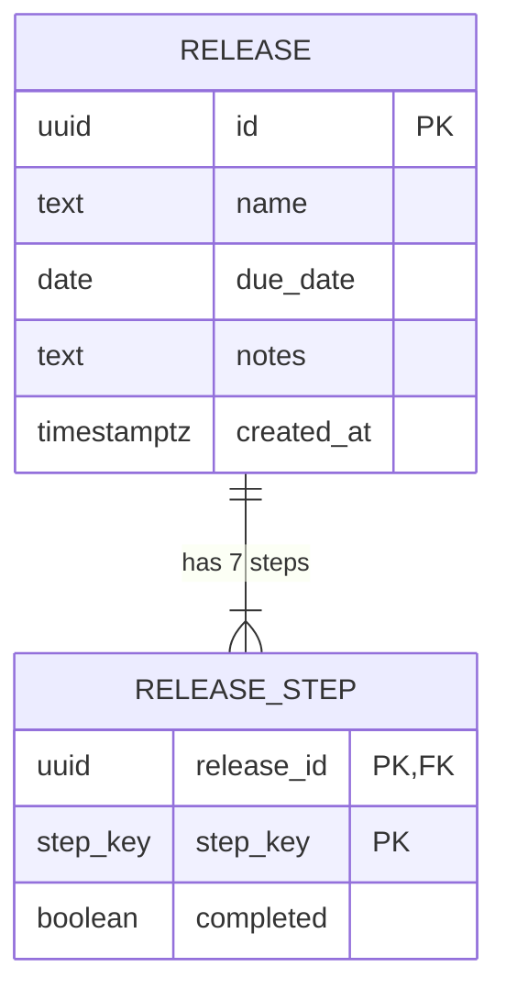

# ReleaseCheck: Backend Design Doc

## 1. Scope

**Problem:** A single-user tool for tracking software releases. Each release has a name, a due date, optional notes, and seven fixed steps that are either done or not. Status is derived from the steps and never stored.

**In scope**
- List releases (sorted by due date, then name).
- Get one release with its steps.
- Create a release (name, due date, optional notes). All seven steps start unchecked.
- Set one step to an explicit on/off value.
- Update the notes of a release.
- Delete a release (cascades to its steps).
- Real-time change events via a GraphQL subscription over SSE, shown as banners in other open tabs.

**Out of scope**
- Authentication and multiple users.
- Editing a release's name or due date after creation (the brief only requires notes to be editable).
- Adding, removing, or reordering steps at runtime.
- Change history or audit logs.
- Pagination (the list is small).
- Multi-instance deployment (the event bus is in-process).

**Stack**
- Repo: a Yarn 4 workspaces monorepo with two workspaces, `web` (frontend) and `server` (backend), and one root `yarn.lock`.
- Backend: Node.js 20+, GraphQL Yoga on `node:http`, plain `pg` with a single `Pool`, raw SQL.
- Migrations: `node-pg-migrate`, SQL files in `server/migrations/`.
- Database: PostgreSQL hosted on Supabase (session pooler string). No local Postgres.
- Tests: Vitest, with integration tests against a dedicated Supabase test project.
- Hosting: API on Render as a native Node service (no Docker). Frontend on Vercel as a static Next.js export with root directory `web`, using urql and `graphql-sse`.
- No ORM. No Docker in the current scope.

**UI styling:** defined in `docs/DESIGN_SYSTEM.md`. The backend doesn't depend on it, but the change banner text and the step labels must match what that file and `STEP_DEFINITIONS` specify.

**Hard rule:** every release's status must equal what its seven step rows imply. Status is never stored, so it can't drift.

## 2. Schema

Applied through `node-pg-migrate`. The first migration is `1700000000000_init.sql`.

```sql
CREATE TYPE step_key AS ENUM (
  'merged_prs', 'changelog_updated', 'tests_passing',
  'github_release_created', 'deployed_demo',
  'tested_demo', 'deployed_production'
);

CREATE TABLE release (
  id          uuid PRIMARY KEY DEFAULT gen_random_uuid(),
  name        text NOT NULL CHECK (btrim(name) <> '' AND char_length(name) <= 100),
  due_date    date NOT NULL,
  notes       text CHECK (notes IS NULL OR char_length(notes) <= 2000),
  created_at  timestamptz NOT NULL DEFAULT now()
);

CREATE INDEX release_due_date_idx ON release (due_date);

CREATE UNIQUE INDEX release_name_lower_idx ON release (lower(name));

CREATE TABLE release_step (
  release_id  uuid NOT NULL REFERENCES release (id) ON DELETE CASCADE,
  step_key    step_key NOT NULL,
  completed   boolean NOT NULL DEFAULT false,
  PRIMARY KEY (release_id, step_key)
);
```

**Down migration:** drop `release_step`, then `release`, then the `step_key` type.

**Seed data:** none in migrations. An optional `npm run seed` script can insert the mockup's sample releases for demos.

**Step definitions** (code constant `STEP_DEFINITIONS`, display order = this list):

| Key | Label |
|---|---|
| `merged_prs` | All relevant GitHub pull requests have been merged |
| `changelog_updated` | CHANGELOG.md files have been updated |
| `tests_passing` | All tests are passing |
| `github_release_created` | Releases in Github created |
| `deployed_demo` | Deployed in demo |
| `tested_demo` | Tested thoroughly in demo |
| `deployed_production` | Deployed in production |

A drift test reads the enum labels from `pg_enum` and compares them with `STEP_DEFINITIONS`.

## 3. Relationships



## 4. Endpoints (GraphQL, single endpoint `POST /graphql`)

### Types

```graphql
enum StepKey { merged_prs changelog_updated tests_passing github_release_created deployed_demo tested_demo deployed_production }
enum ReleaseStatus { PLANNED ONGOING DONE }
enum ChangeKind { STEP_CHANGED NOTES_CHANGED RELEASE_CREATED RELEASE_DELETED }

type Step { key: StepKey!  label: String!  completed: Boolean! }

type Release {
  id: ID!
  name: String!
  dueDate: String!        # YYYY-MM-DD
  notes: String
  status: ReleaseStatus!  # derived: 0 done = PLANNED, 1-6 = ONGOING, 7 = DONE
  steps: [Step!]!         # always 7, in STEP_DEFINITIONS order
}

type ReleaseChange {
  releaseId: ID!
  kind: ChangeKind!
  stepKey: StepKey        # STEP_CHANGED only
  completed: Boolean      # STEP_CHANGED only
  sourceClientId: String! # tab that made the change
}
```

### Queries

| Operation | Arguments | Returns | Behaviour |
|---|---|---|---|
| `releases` | none | `[Release!]!` | Sorted by `due_date`, then `name`. `[]` when empty. |
| `release` | `id: ID!` | `Release` | `null` if not found. |

### Mutations

| Operation | Arguments | Returns | Behaviour |
|---|---|---|---|
| `createRelease` | `name: String!`, `dueDate: String!`, `notes: String`, `clientId: String!` | `Release!` | Inserts release and seven unchecked steps in one transaction. Rejects a name that matches an existing release, ignoring letter case. |
| `setStepCompleted` | `releaseId: ID!`, `stepKey: StepKey!`, `completed: Boolean!`, `clientId: String!` | `Release!` | Sets the explicit value. Not a toggle. |
| `updateReleaseNotes` | `id: ID!`, `notes: String`, `clientId: String!` | `Release!` | Blank notes store `null`. |
| `deleteRelease` | `id: ID!`, `clientId: String!` | `Boolean!` | Cascades to steps. |

### Subscription

| Operation | Arguments | Payload | Behaviour |
|---|---|---|---|
| `releaseChanged` | none | `ReleaseChange!` | Emits after each committed mutation. Sent over SSE. |

### Validation

| Field | Rule | Error |
|---|---|---|
| `name` | Trimmed, 1 to 100 characters. Unique compared with `lower(name)`. | `BAD_USER_INPUT` |
| `dueDate` | Real calendar date, `YYYY-MM-DD`. Past dates allowed. | `BAD_USER_INPUT` |
| `notes` | At most 2,000 characters. Blank becomes `null`. | `BAD_USER_INPUT` |
| `id`, `releaseId` | Valid UUID | `BAD_USER_INPUT` |
| `stepKey` | Enum, checked by GraphQL before resolvers | GraphQL validation error |
| `clientId` | Non-empty string, at most 64 characters | `BAD_USER_INPUT` |

### Error codes

- `BAD_USER_INPUT`: validation failed. `extensions.field` names the field.
- `NOT_FOUND`: the release or step doesn't exist, for example after a delete.
- `INTERNAL_SERVER_ERROR`: anything unexpected. Details are logged, not returned.

## 5. Transactions and concurrency

**Transaction boundaries**

| Operation | Transaction | Rollback trigger |
|---|---|---|
| `createRelease` | `BEGIN`, insert `release`, insert 7 rows from `SELECT unnest(enum_range(NULL::step_key))`, `COMMIT` | Any error |
| `setStepCompleted` | `BEGIN`, `UPDATE` one row (must affect 1 row), read release, `COMMIT` | Zero rows affected (`NOT_FOUND`), any error |
| `updateReleaseNotes` | Single statement with `RETURNING` | Zero rows (`NOT_FOUND`) |
| `deleteRelease` | Single statement with `RETURNING` | Zero rows (`NOT_FOUND`) |
| `releases` / `release` | Read-only | None |

**SQL**

```sql
-- setStepCompleted
UPDATE release_step
SET completed = $3
WHERE release_id = $1 AND step_key = $2;

-- releases: fetch all steps in one query, no N+1
SELECT release_id, step_key, completed
FROM release_step
WHERE release_id = ANY($1);
```

**Event publishing**
- Publish a `ReleaseChange` event only after `COMMIT` succeeds, never inside the transaction.
- Use an in-process pub/sub channel. This is correct for one Render instance.
- `pubsub.ts` wraps Yoga's `createPubSub` and exposes exactly two functions:
  - `publish(change: ReleaseChange): void`, called by services after commit.
  - `subscribe(): AsyncIterable<ReleaseChange>`, used by the `releaseChanged` subscription resolver.
- The pub/sub instance is a module-level singleton. Tests reset it between cases.

**Subscription endpoint and transport**
- The subscription runs on the same `/graphql` path as queries and mutations. Yoga selects SSE when the request has `Accept: text/event-stream`.
- Setup step 1 of the build: confirm the exact SSE behaviour for the installed Yoga version with a manual subscription in GraphiQL. Record the result in the README. If Yoga requires a different path, update section 4 before continuing.
- The client uses the `graphql-sse` client, connected to the same URL, through urql's subscription exchange.

**Client identity**
- `clientId` is generated once per tab with `crypto.randomUUID()` and stored in `sessionStorage` under the key `releasecheck.clientId`. A page refresh keeps the same ID. A new tab gets a new ID.
- Every mutation sends the `clientId` argument. The client never reuses a value from another tab.

**Concurrency rules**
- Each step update is a single-row `UPDATE`. Postgres locks that row for the statement, so different steps on the same release never overwrite each other.
- Two clients setting the same step: last write wins. Because each write carries an explicit value, the final state is always one of the values sent.
- A step update racing a delete: the `UPDATE` finds no row and returns `NOT_FOUND`.
- Lock order: no mutation locks more than one release. `deleteRelease` locks the release row, and the cascade removes its steps in the same statement.
- Other tabs see changes through the subscription. A tab that reconnects refetches the open release. Reconnecting does not refetch the homepage list.

**Subscription behaviour**
- Served over SSE by GraphQL Yoga. The server sends a keepalive every 15 to 30 seconds.
- The client includes a random `clientId` with every mutation. Events carry it back as `sourceClientId`, and the originating tab ignores events it sent itself.
- Client behaviour per event:
  - `STEP_CHANGED`: refetch that release's cached detail and the homepage list in every other open tab, and show a dismissible banner, for example `Checkbox "All tests are passing" was checked in another tab`. Several changes collapse into "3 changes from another tab". A form with unsaved notes or steps keeps that draft; the detail refetch does not overwrite it. The list refetch updates the status column, which is derived from the steps. The tab that saved ignores this event. After its step writes finish, it refetches the list itself and writes the detail cache from a follow-up read, because those mutation results have `__typename` removed.
  - `NOTES_CHANGED`: refetch that release's cached detail in every other open tab and show the banner. Notes do not change status, so the homepage list stays cached. The tab that saved writes the detail cache from a follow-up read.
  - `RELEASE_CREATED`: refetch the homepage list in every other open tab, with no banner. The tab that created the release updates its cached list from the `createRelease` result.
  - `RELEASE_DELETED`: refetch the homepage list and that release's cached detail in every other open tab, with no banner. A tab that has the release open then shows that it no longer exists. The tab that deleted the release drops that row from the cached list without waiting for the refetch. `deleteRelease` returns a boolean, so the document cache does not drop the list on its own.

**Homepage list**
- The homepage reads `releases` through urql's document cache (`cache-first`). A later visit uses the cached list.
- That cache is refetched when a release is created, deleted, or its steps are saved. A notes-only save does not refetch it. Status is derived from the completed steps, so a step save has to refresh the list or the status column stays stale when the user returns.
- `setStepCompleted` and `updateReleaseNotes` return a `Release`. The client strips `__typename` from those two results so each mutation does not refetch `releases` on its own. The saving tab refetches the list once after its step writes, which is the final status. `createRelease` keeps `__typename`, so the creating tab's cached list is invalidated and refetched. If that new release also saved completed steps, the tab refetches the list again after those steps.

**Release page**
- An existing release is read with `release(id)` through the same document cache (`cache-first`). Opening that release again in the tab uses the cached detail. A new live connection when the page opens is not a reconnect, so it does not refetch.
- Other tabs refresh that cache entry when the release's steps or notes are saved, and when the release is deleted. A tab that is not on the page still updates the entry, so the next open is current.
- The tab that saved does not apply its own subscription event. It refreshes its detail cache with an explicit read after the save succeeds.
- A new release form does not read `release(id)`.

**Form drafts**
- Checklist and notes are local drafts until Save. Toggling a checkbox does not call `setStepCompleted`.
- Save on an existing release calls `setStepCompleted` for each step whose `completed` value differs from the release last loaded into that form, then calls `updateReleaseNotes` only when the notes differ from that same loaded release.
- Other tabs learn about a step only after that save commits.
- Leaving the form without Save discards unsaved toggles and notes.
- A later Save from a dirty form sends only the steps and notes that form changed. Another person's saved fields stay unless this form changed them too. The same step is last save wins.

## 6. Edge cases

| Case | Expected result |
|---|---|
| Name `"   "` | `BAD_USER_INPUT` |
| Name of 101 characters | `BAD_USER_INPUT` |
| Name that matches an existing release, ignoring letter case | `BAD_USER_INPUT`, field `name` |
| `dueDate` of `2026-02-30` | `BAD_USER_INPUT` |
| `dueDate` in the past | Accepted |
| `notes` of `""` or spaces | Stored as `null` |
| `notes` of 2,001 characters | `BAD_USER_INPUT` |
| `setStepCompleted(true)` twice | Same state both times, no error |
| Unknown `stepKey` | GraphQL validation error |
| Step update on a deleted release | `NOT_FOUND` |
| Delete the same release twice | Second call returns `NOT_FOUND` |
| `release(id)` for an unknown ID | `null` |
| Update notes of a deleted release | `NOT_FOUND` |
| Seven steps completed | Status `DONE` |
| Empty database | `releases` returns `[]` |
| Two tabs toggle the same step | Unsaved toggles stay local. If both later save that step, the later save wins |
| Mutation fails and rolls back | No event is published |
| Subscriber disconnects during a change | On reconnect the tab refetches the open release |

## 7. Acceptance tests

Run against the Supabase test project. Reset with `TRUNCATE release CASCADE;` before each test file.

| # | Setup | Action | Expected result | DB check |
|---|---|---|---|---|
| 1 | Empty DB | `createRelease` with name, date, notes | Release with 7 steps, all `false`, status `PLANNED` | 1 row in `release`, 7 in `release_step` |
| 2 | One release | `setStepCompleted(merged_prs, true)` | Status `ONGOING`, that step `true` | 1 row changed |
| 3 | Release with 6 done | `setStepCompleted(last, true)` | Status `DONE` | All 7 true |
| 4 | One release | `setStepCompleted(merged_prs, true)` twice | No error, same result | Still one row, `true` |
| 5 | One release | `setStepCompleted(x, false)` | Step unchecked, status recomputed | Row is `false` |
| 6 | One release | `updateReleaseNotes("")` | Notes `null` | `notes IS NULL` |
| 7 | One release | `deleteRelease` | `true` returned | 0 rows in both tables |
| 8 | Release deleted | `setStepCompleted` on its ID | `NOT_FOUND` | No rows created |
| 9 | Invalid input | `createRelease` with empty name | `BAD_USER_INPUT`, field `name` | No rows created |
| 10 | Subscriber open | Mutation from another `clientId` | Event received with `STEP_CHANGED` and `sourceClientId` | n/a |
| 11 | Subscriber open | Mutation from the same `clientId` | Event received, client ignores it | n/a |
| 12 | Subscriber open | Mutation that fails validation | No event | n/a |
| 13 | Ten releases | `releases` query | Sorted by due date, 70 step rows fetched in one query | n/a |
| 14 | Drift test | Compare `STEP_DEFINITIONS` to `pg_enum` labels | Identical lists | n/a |

## 8. Done criteria

- [ ] All six operations and the subscription work as described in section 4.
- [ ] Migrations run cleanly on a fresh Supabase project, and the down migration works.
- [ ] Status is computed in one pure function with unit tests for 0, 1 to 6, and 7 steps.
- [ ] Acceptance tests 1 to 14 pass.
- [ ] Validation errors return the codes in section 4.
- [ ] Subscription events are published only after commit.
- [ ] The GraphQL playground is available locally and disabled in production.
- [ ] `yarn start` starts the web app and the server together, and both connect to Supabase.
- [ ] The server deploys to Render as a native Node service, and the web app deploys to Vercel with root directory `web`.
- [ ] The UI matches `docs/DESIGN_SYSTEM.md`, including the change banner and the empty and not-found states.
- [ ] Deployed API, frontend, and database are reachable and documented in the README.

## 9. Questions and stretch items

**Open questions:** none outstanding. Defaults in section 1 are confirmed.

**Stretch items, in priority order:**
1. Version check on `release_step` to reject stale writes with `CONFLICT`.
2. Editing name and due date after creation.
3. Pagination on `releases`.
4. A shared broker (Postgres `LISTEN/NOTIFY`) if the API is ever run on more than one instance.
5. Step change history.
